> **文档元信息**
>
> | 项目 | 内容 |
> |------|------|
> | 文档版本 | v1.0 |
> | 作者 | AiWork |
> | 创建日期 | 2026-10-29 |
> | 需求来源 | 用户需求描述（三接口 + 前端 Tab 页 + 导出 + 埋点可视化报表） |
> | 评审状态 | 待评审 |

# 算法演示与调用埋点可视化 系分设计

## 1. 需求与范围

### 背景与目标

PakePlus 是一个基于 Tauri（Rust 后端 + Vue 3 前端）的桌面应用，当前主要用于将网页打包为桌面/移动应用。本次需求在此基础上新增一套"算法演示 + 调用埋点可视化"功能模块，目的是：

1. **提供三个算法演示接口**：HelloWorld、哈希算法、冒泡排序，用户可在前端页面切换 Tab 查看不同接口的执行结果。
2. **导出能力**：前端提供导出按钮，后端提供导出接口，支持将各 Tab 页面的展示结果导出为文件。
3. **调用埋点**：后端在每次接口调用时记录调用次数和调用人信息。
4. **可视化报表**：前端在当前页面上展示调用情况的报表，支持按人员类型、人员层级、人员部门等维度查看，提供折线图、饼图、柱状图三种展示形式。

### 核心功能

- **F01 三算法接口**：后端实现 HelloWorld、哈希算法（对输入文本计算哈希值）、冒泡排序（对输入数组进行排序）三个 Tauri Command 接口。
- **F02 前端 Tab 页**：新增一个 Vue 页面，包含三个 Tab（HelloWorld / 哈希算法 / 冒泡排序），每个 Tab 展示对应接口的执行结果，支持用户输入参数并触发执行。
- **F03 导出功能**：前端页面新增导出按钮，后端提供导出 Tauri Command 接口，支持将当前 Tab 或全部 Tab 的展示结果导出为 CSV 文件。
- **F04 调用埋点**：后端在三个算法接口和导出接口每次被调用时，记录调用时间、调用接口名称、调用人标识（机器 UID）、人员类型、人员层级、人员部门等信息到本地 SQLite 数据库。
- **F05 可视化报表**：前端在同一页面新增报表区域，通过调用埋点查询接口获取统计数据，使用 ECharts 渲染折线图、饼图、柱状图，支持按人员类型、人员层级、人员部门等维度切换。

### 约束与非功能要求

- **技术栈约束**：后端基于 Rust/Tauri 2.x，前端基于 Vue 3 + Element Plus + Vue Router + Pinia + Vite；不得引入与现有技术栈冲突的框架。
- **数据存储约束**：桌面应用无远程数据库，埋点数据存储在本地 SQLite（通过 `rusqlite` 或 `tauri-plugin-sql`）。
- **性能要求**：算法接口响应时间 < 100ms（本地计算）；埋点写入不阻塞主流程（异步写入）；报表查询响应 < 500ms。
- **跨平台约束**：需兼容 Windows、macOS、Linux 三个桌面平台；导出文件路径需使用 Tauri 文件对话框让用户选择。
- **图表库约束**：前端图表使用 ECharts（轻量、生态成熟、支持折线/饼图/柱状图）。

### 排除范围

- 不涉及 PakePlus 现有的网页打包、构建、发布等功能模块的改动。
- 不涉及远程服务端或云端数据库；所有数据均在本地。
- 不涉及用户登录注册系统；调用人标识使用本地机器 UID + 本地配置的人员信息。
- 不涉及 iOS 仓库（PakePlus-iOS）的改动；本次仅涉及 PakePlus 主仓库。
- 不涉及多用户并发场景；桌面应用为单用户本地使用。

### 需求功能清单与优先级

| 编号 | 功能点 | 优先级 | PRD 原始描述/章节 | 备注 |
|------|--------|--------|-------------------|------|
| F01 | HelloWorld 接口 | P0 | "分别写三个接口helloworld" | 返回固定问候字符串 |
| F02 | 哈希算法接口 | P0 | "哈希算法" | 对输入文本计算 SHA-256 哈希值 |
| F03 | 冒泡排序接口 | P0 | "冒泡排序" | 对输入数字数组进行冒泡排序并返回结果 |
| F04 | 前端三 Tab 页面 | P0 | "前端新增一个页面，有三个tab分别展示不同的执行结果" | Vue 页面 + Element Plus Tabs |
| F05 | 导出按钮 + 导出接口 | P1 | "新增导出按钮，后台提供导出接口，支持导出各个页面的展示结果" | 导出为 CSV |
| F06 | 调用埋点记录 | P1 | "后端再做个埋点，获取调用次数和调用人" | 每次接口调用写入 SQLite |
| F07 | 可视化报表 - 折线图 | P1 | "折线图...不同展示形式" | 按时间维度展示调用趋势 |
| F08 | 可视化报表 - 饼图 | P1 | "饼图...不同展示形式" | 按维度占比展示 |
| F09 | 可视化报表 - 柱状图 | P1 | "柱状图...不同展示形式" | 按维度对比展示 |
| F10 | 多维度筛选 | P1 | "根据不同的维度：人员类型、人员层级、人员部门等" | 支持维度切换 |

### 假设与待确认项

| 编号 | 假设/待确认内容 | 当前假设 | 确认状态 |
|------|-----------------|----------|----------|
| A01 | 哈希算法具体类型 | 假设使用 SHA-256（最通用），同时返回 MD5/SHA-1/SHA-256 三种结果供参考 | 待确认 |
| A02 | 冒泡排序输入数据来源 | 假设由前端用户输入一组数字（逗号分隔），后端解析为数组后排序 | 待确认 |
| A03 | 调用人的人员信息来源 | 假设通过本地配置文件（Tauri Store）维护人员类型/层级/部门信息，首次使用时引导用户填写 | 待确认 |
| A04 | 人员类型维度取值 | 假设枚举：开发者/测试人员/产品经理/其他 | 待确认 |
| A05 | 人员层级维度取值 | 假设枚举：初级/中级/高级/专家 | 待确认 |
| A06 | 人员部门维度取值 | 假设为用户自由输入的部门名称字符串 | 待确认 |
| A07 | 导出文件格式 | 假设导出为 CSV 文件（通用、轻量） | 待确认 |
| A08 | 图表库选型 | 假设使用 ECharts 5.x（Vue 生态中 echarts + vue-echarts 组合最成熟） | 待确认 |
| A09 | 数据存储方案 | 假设使用 SQLite（通过 rusqlite crate），数据库文件存放在应用数据目录 | 待确认 |
| A10 | 报表时间范围 | 假设默认展示最近 7 天数据，支持切换为最近 30 天/全部 | 待确认 |

---

## 2. 架构与模块

### 功能架构

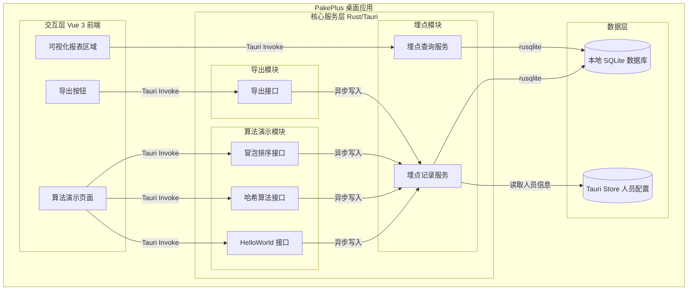

- **交互层说明**：Vue 3 前端新增一个算法演示页面（AlgoPage），包含三个 Tab 分别对应三个算法接口；页面顶部有导出按钮（ExportBtn）；页面下方有可视化报表区域（ReportPanel），包含折线图、饼图、柱状图和维度切换控件。
- **核心服务层说明**：
  - **算法演示模块**：三个 Tauri Command 函数，分别实现 HelloWorld、哈希算法、冒泡排序逻辑，每次调用后触发埋点记录。
  - **导出模块**：一个 Tauri Command 函数，根据传入的 Tab 类型收集对应结果数据，生成 CSV 内容，通过 Tauri 文件对话框让用户选择保存路径。
  - **埋点模块**：埋点记录服务负责异步写入调用日志；埋点查询服务负责按维度聚合统计数据返回给前端。
- **数据层说明**：SQLite 存储埋点记录表；Tauri Store 存储本地人员配置信息（类型/层级/部门）。

**模块清单**

| 模块 | 职责 | 依赖 |
|------|------|------|
| 算法演示模块 | 实现 HelloWorld、哈希算法、冒泡排序三个接口的计算逻辑 | 埋点模块（调用后记录） |
| 导出模块 | 将算法执行结果导出为 CSV 文件 | 算法演示模块（获取结果）、埋点模块（记录导出调用） |
| 埋点模块 | 记录每次接口调用日志，提供按维度聚合查询 | SQLite 数据库、Tauri Store（人员信息） |
| 前端算法演示页面 | 提供三 Tab 交互、参数输入、结果展示、导出触发、报表渲染 | ECharts 图表库、Element Plus 组件库 |


### 应用集成架构

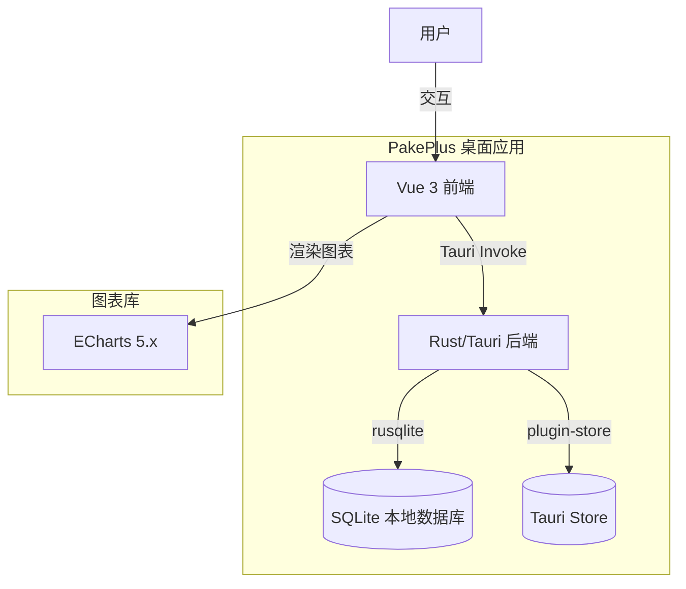

**集成关系说明：**

| 调用方 | 被调用方 | 协议 | 接口类型 | 说明 |
|--------|----------|------|----------|------|
| 用户 | Vue 3 前端 | UI 交互 | 浏览器事件 | 用户在页面上输入参数、切换 Tab、点击导出、切换维度 |
| Vue 3 前端 | Rust/Tauri 后端 | Tauri IPC | Tauri Command | 前端通过 `@tauri-apps/api` 的 `invoke` 调用后端命令 |
| Rust 后端 | SQLite | rusqlite | SQL | 埋点数据的写入和查询 |
| Rust 后端 | Tauri Store | plugin-store | Key-Value | 读取本地人员配置信息 |
| Vue 3 前端 | ECharts | JS import | 图表渲染 | 报表区域使用 ECharts 渲染折线/饼/柱状图 |

### 部署架构

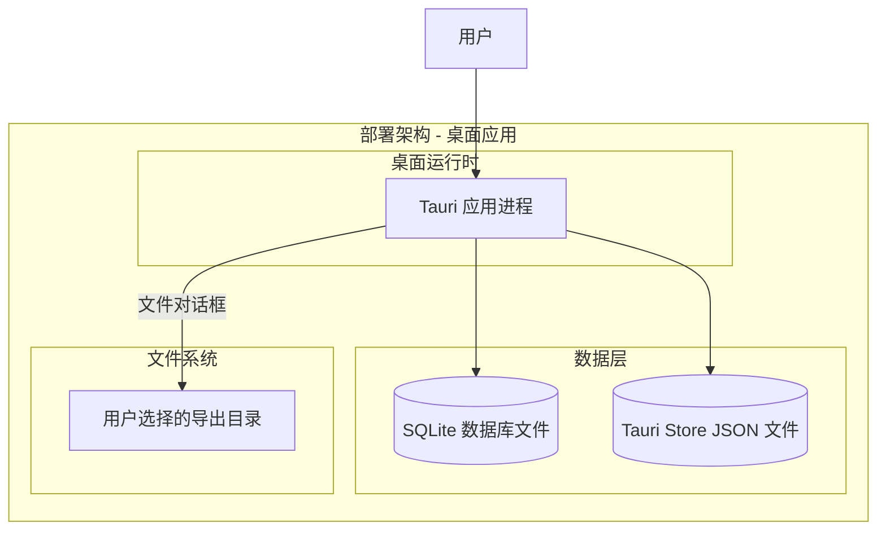

**部署说明：**
- **桌面运行时**：PakePlus 作为 Tauri 桌面应用，编译为原生可执行文件，在用户本地运行，无需服务端部署。应用进程内嵌 WebView（前端）和 Rust 运行时（后端）。
- **数据层**：SQLite 数据库文件存放在 Tauri 应用数据目录（`app_data_dir`），Tauri Store 以 JSON 文件形式存放在同一目录。数据库文件随应用数据自动管理。
- **文件系统**：导出文件由用户通过 Tauri 文件对话框选择保存路径，不限定固定目录。


---

## 3. 数据模型与存储

### 实体清单

| 实体名称 | 实体说明 | 所属模块 | 与其他实体的关系 |
|----------|----------|----------|-----------------|
| call_log | 接口调用埋点记录，每次调用算法接口或导出接口时写入一条日志 | 埋点模块 | 无关联实体（独立日志表） |
| user_profile | 用户人员信息配置，存储当前桌面用户的类型、层级、部门信息 | 埋点模块 | 作为 call_log 的人员信息来源（非外键关联，冗余写入 call_log） |

### 实体关系图

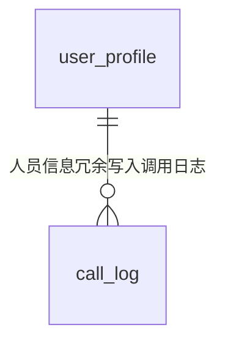

**模型说明：**
- `user_profile` 是单例配置（当前桌面应用只有一个用户），存储在 Tauri Store 中（Key-Value JSON），不在 SQLite 中建表。
- `call_log` 每次接口调用时写入一条记录，其中人员类型/层级/部门字段从 `user_profile` 读取后冗余写入，避免查询时需要关联 Tauri Store。
- 采用冗余设计的原因：Tauri Store 是 Key-Value 存储，无法与 SQLite 做 JOIN 查询，因此将人员信息冗余到 call_log 中以支持按维度聚合查询。

---

## 4. 接口设计

### 4.1 Tauri Command 接口（前端调后端）

| 编号 | 接口名称 | 方法 | 路径（Command 名称） | 模块 |
|------|----------|------|------|------|
| T01 | HelloWorld | Tauri Invoke | `helloworld` | 算法演示模块 |
| T02 | 哈希算法 | Tauri Invoke | `hash_algorithm` | 算法演示模块 |
| T03 | 冒泡排序 | Tauri Invoke | `bubble_sort` | 算法演示模块 |
| T04 | 导出结果 | Tauri Invoke | `export_results` | 导出模块 |
| T05 | 查询埋点统计 | Tauri Invoke | `query_call_stats` | 埋点模块 |
| T06 | 保存用户人员信息 | Tauri Invoke | `save_user_profile` | 埋点模块 |
| T07 | 获取用户人员信息 | Tauri Invoke | `get_user_profile` | 埋点模块 |

### 4.2 OpenAPI（对外接口）

本项不适用，原因：PakePlus 是桌面应用，不对外提供 HTTP REST API，所有接口通过 Tauri IPC 调用。

### 4.3 内部接口（Rust 模块间）

| 编号 | 接口名称 | 模块 | 方法签名 | 说明 |
|------|----------|------|----------|------|
| S01 | 记录调用埋点 | 埋点模块 | `track_call(interface_name, user_profile) -> Result<(), String>` | 算法/导出接口调用后异步触发 |
| S02 | 初始化数据库 | 埋点模块 | `init_db(app_data_dir) -> Result<Connection, String>` | 应用启动时创建表结构 |
| S03 | 获取数据库连接 | 埋点模块 | `get_db_connection(app_handle) -> Result<Connection, String>` | 从应用状态中获取已初始化的连接 |

### 4.4 集成接口（Integration 层）

本项不适用，原因：无外部系统集成，所有数据在本地完成。

---

## 5. 功能模块设计

### 全局约定

| 约定项 | 约定值 |
|--------|--------|
| 错误码格式 | `{MODULE}_{SEQ}`，如 `ALGO_001`、`TRACK_001`、`EXPORT_001` |
| 通用出参结构 | Tauri Command 返回 `Result<T, String>`，其中 `T` 为业务数据结构（Serialize），`String` 为错误描述 |
| 通用入参约定 | 所有接口入参使用具名参数（Tauri Command 风格），前端通过 `invoke(command_name, { args })` 调用 |

**模块映射表：**

| 模块代码 | 模块名称 | 错误码前缀 |
|----------|----------|------------|
| ALGO | 算法演示模块 | ALGO |
| EXPORT | 导出模块 | EXPORT |
| TRACK | 埋点模块 | TRACK |
| PROFILE | 用户人员信息模块 | PROFILE |

---

### 5.1 算法演示模块

#### 5.1.1 表结构设计

本模块无独立表结构设计。算法接口为纯计算逻辑，不涉及数据持久化。计算结果直接通过 Tauri Command 返回值传递给前端。

#### 5.1.2 枚举与常量定义

| 枚举名称 | 取值 | 含义 | 关联字段 |
|----------|------|------|----------|
| InterfaceType | helloworld | HelloWorld 接口 | call_log.interface_name |
| InterfaceType | hash_algorithm | 哈希算法接口 | call_log.interface_name |
| InterfaceType | bubble_sort | 冒泡排序接口 | call_log.interface_name |
| InterfaceType | export_results | 导出接口 | call_log.interface_name |
| HashAlgorithm | md5 | MD5 哈希 | 哈希结果中的 algorithm 字段 |
| HashAlgorithm | sha1 | SHA-1 哈希 | 哈希结果中的 algorithm 字段 |
| HashAlgorithm | sha256 | SHA-256 哈希 | 哈希结果中的 algorithm 字段 |

#### 5.1.3 接口详细设计

##### T01 HelloWorld 接口

- **URI**: Tauri Invoke `helloworld`
- **描述**: 返回固定的 HelloWorld 问候字符串，同时触发埋点记录
- **入参**: 无

- **出参**:

| 参数名称 | 类型 | 描述 |
|----------|------|------|
| message | String | 问候消息内容，固定为 "Hello, World! Welcome to PakePlus Algorithm Demo." |
| timestamp | String | 服务器时间戳（ISO 8601 格式） |

- **错误码**:

| 错误码 | 说明 |
|--------|------|
| ALGO_001 | 埋点记录失败（不阻断返回结果，仅记录日志） |

- **业务规则**: 无输入参数，直接返回固定字符串。埋点记录失败时不阻断接口返回。

- **请求示例**:
```json
{}
```

- **响应示例**:
```json
{
  "message": "Hello, World! Welcome to PakePlus Algorithm Demo.",
  "timestamp": "2026-10-29T08:30:00Z"
}
```

##### T02 哈希算法接口

- **URI**: Tauri Invoke `hash_algorithm`
- **描述**: 对输入文本计算 MD5、SHA-1、SHA-256 三种哈希值并返回
- **入参**:

| 参数名称 | 类型 | 是否必填 | 描述 |
|----------|------|----------|------|
| input_text | String | 是 | 待计算哈希的文本内容 |

- **出参**:

| 参数名称 | 类型 | 描述 |
|----------|------|------|
| input_text | String | 原始输入文本 |
| md5 | String | MD5 哈希值（32 位十六进制字符串） |
| sha1 | String | SHA-1 哈希值（40 位十六进制字符串） |
| sha256 | String | SHA-256 哈希值（64 位十六进制字符串） |
| timestamp | String | 计算时间戳（ISO 8601 格式） |

- **错误码**:

| 错误码 | 说明 |
|--------|------|
| ALGO_002 | 输入文本为空 |
| ALGO_003 | 哈希计算失败（内部错误） |
| ALGO_001 | 埋点记录失败（不阻断返回结果） |

- **业务规则**:
  - R01：输入文本不能为空，否则返回 ALGO_002。
  - R02：同时计算三种哈希算法结果，一次性返回。

- **请求示例**:
```json
{
  "input_text": "PakePlus"
}
```

- **响应示例**:
```json
{
  "input_text": "PakePlus",
  "md5": "a1b2c3d4e5f6...",
  "sha1": "f1e2d3c4b5a6...",
  "sha256": "e1d2c3b4a596...",
  "timestamp": "2026-10-29T08:35:00Z"
}
```

##### T03 冒泡排序接口

- **URI**: Tauri Invoke `bubble_sort`
- **描述**: 对输入的数字数组进行冒泡排序，返回排序前后的数组对比
- **入参**:

| 参数名称 | 类型 | 是否必填 | 描述 |
|----------|------|----------|------|
| numbers | Vec<f64> | 是 | 待排序的数字数组 |
| order | String | 否 | 排序顺序，"asc"（升序，默认）或 "desc"（降序） |

- **出参**:

| 参数名称 | 类型 | 描述 |
|----------|------|------|
| original | Vec<f64> | 原始输入数组 |
| sorted | Vec<f64> | 排序后数组 |
| order | String | 实际排序方向 |
| swap_count | i32 | 冒泡排序过程中交换次数 |
| timestamp | String | 排序时间戳（ISO 8601 格式） |

- **错误码**:

| 错误码 | 说明 |
|--------|------|
| ALGO_004 | 输入数组为空 |
| ALGO_005 | 输入数组长度超过 10000（防止性能问题） |
| ALGO_006 | order 参数值非法（非 asc/desc） |
| ALGO_001 | 埋点记录失败（不阻断返回结果） |

- **业务规则**:
  - R01：输入数组不能为空，否则返回 ALGO_004。
  - R02：输入数组长度上限 10000，超过则返回 ALGO_005。
  - R03：order 参数仅接受 "asc" 或 "desc"，默认 "asc"，非法值返回 ALGO_006。
  - R04：记录排序过程中的交换次数，用于前端展示算法效率信息。

- **请求示例**:
```json
{
  "numbers": [5, 3, 8, 1, 9, 2, 7],
  "order": "asc"
}
```

- **响应示例**:
```json
{
  "original": [5, 3, 8, 1, 9, 2, 7],
  "sorted": [1, 2, 3, 5, 7, 8, 9],
  "order": "asc",
  "swap_count": 12,
  "timestamp": "2026-10-29T08:40:00Z"
}
```

#### 5.1.4 子功能详细设计

##### 5.1.4.1 HelloWorld 执行流程（F01）

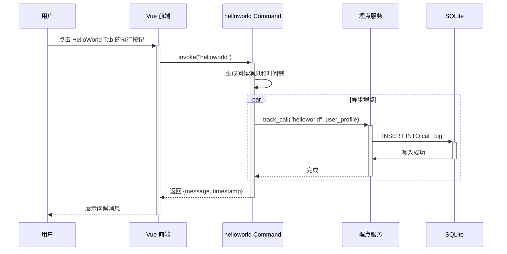

**业务规则：**

| 规则编号 | 规则描述 | 校验时机 | 不满足时的处理 |
|----------|----------|----------|--------------|
| R01 | 无输入参数，直接生成结果 | 始终 | 不适用 |
| R02 | 埋点记录异步执行，不阻断主流程 | 调用后 | 埋点失败仅记录 Rust 日志，不影响接口返回 |

**异常场景：**

| 异常场景 | 处理方式 |
|----------|----------|
| SQLite 数据库未初始化 | 埋点服务检测到连接不可用时跳过写入，记录 warn 日志 |
| 埋点写入超时 | 异步任务设置 3 秒超时，超时后放弃，不影响主接口 |

**并发控制：**
- 并发场景：桌面应用单用户使用，无并发风险。
- 控制策略：无并发风险，原因：桌面应用为单用户本地使用，不存在多用户并发调用。

##### 5.1.4.2 哈希算法执行流程（F02）

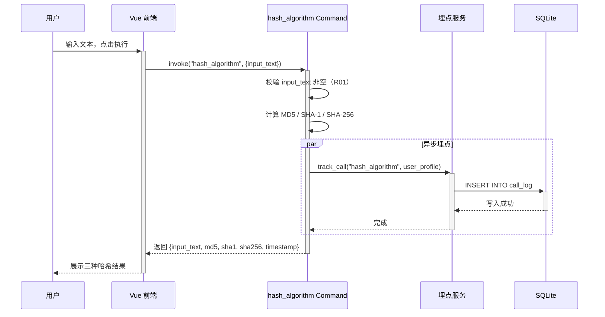

**业务规则：**

| 规则编号 | 规则描述 | 校验时机 | 不满足时的处理 |
|----------|----------|----------|--------------|
| R01 | input_text 不能为空 | 调用时 | 返回错误 ALGO_002，提示"输入文本不能为空" |
| R02 | 同时计算三种哈希结果 | 计算时 | 不适用 |

**异常场景：**

| 异常场景 | 处理方式 |
|----------|----------|
| 哈希计算内部错误 | 返回 ALGO_003，提示"哈希计算失败" |
| 输入文本过长（>1MB） | 截断到 1MB 后计算，前端提示已截断 |

**并发控制：**
- 并发场景：无并发风险，原因：桌面应用单用户本地使用。

##### 5.1.4.3 冒泡排序执行流程（F03）

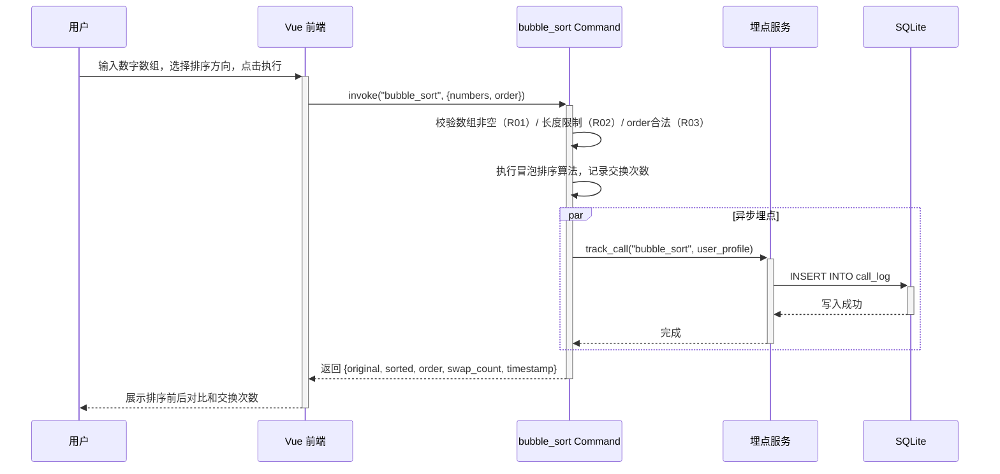

**业务规则：**

| 规则编号 | 规则描述 | 校验时机 | 不满足时的处理 |
|----------|----------|----------|--------------|
| R01 | numbers 不能为空 | 调用时 | 返回 ALGO_004 |
| R02 | numbers 长度 ≤ 10000 | 调用时 | 返回 ALGO_005 |
| R03 | order 仅接受 asc/desc | 调用时 | 返回 ALGO_006 |
| R04 | 记录交换次数 | 排序过程中 | 不适用 |

**异常场景：**

| 异常场景 | 处理方式 |
|----------|----------|
| 数组包含非数字值 | 前端输入校验拦截，后端使用 f64 类型自动解析 |
| 排序过程中内存不足 | 返回通用错误，提示"数组过大" |

**并发控制：**
- 并发场景：无并发风险，原因：桌面应用单用户本地使用。

---

### 5.2 导出模块

#### 5.2.1 表结构设计

本模块无独立表结构设计。导出结果为临时生成的 CSV 文件内容，不持久化存储。

#### 5.2.2 枚举与常量定义

| 枚举名称 | 取值 | 含义 | 关联字段 |
|----------|------|------|----------|
| ExportScope | current | 导出当前 Tab 结果 | export_results 入参 scope |
| ExportScope | all | 导出全部 Tab 结果 | export_results 入参 scope |

#### 5.2.3 接口详细设计

##### T04 导出结果接口

- **URI**: Tauri Invoke `export_results`
- **描述**: 将指定范围的算法执行结果导出为 CSV 文件，通过 Tauri 文件对话框让用户选择保存路径
- **入参**:

| 参数名称 | 类型 | 是否必填 | 描述 |
|----------|------|----------|------|
| scope | String | 是 | 导出范围，"current"（当前 Tab）或 "all"（全部 Tab） |
| current_tab | String | 否 | 当 scope 为 current 时，指定导出的 Tab 名称：helloworld / hash_algorithm / bubble_sort |
| results | Array<Object> | 是 | 待导出的结果数据数组，前端将各 Tab 的最近一次执行结果传入 |

- **出参**:

| 参数名称 | 类型 | 描述 |
|----------|------|------|
| file_path | String | 导出文件的保存路径 |
| file_size | i64 | 导出文件大小（字节） |
| row_count | i32 | 导出数据行数 |
| timestamp | String | 导出时间戳（ISO 8601 格式） |

- **错误码**:

| 错误码 | 说明 |
|--------|------|
| EXPORT_001 | scope 参数值非法 |
| EXPORT_002 | results 为空 |
| EXPORT_003 | 用户取消了文件保存对话框 |
| EXPORT_004 | 文件写入失败 |
| EXPORT_005 | 埋点记录失败（不阻断） |

- **业务规则**:
  - R01：scope 仅接受 "current" 或 "all"，否则返回 EXPORT_001。
  - R02：results 不能为空数组，否则返回 EXPORT_002。
  - R03：通过 Tauri `dialog.save` API 弹出文件保存对话框，用户取消时返回 EXPORT_003。
  - R04：CSV 文件第一行为表头，根据 Tab 类型动态生成列名。

- **请求示例**:
```json
{
  "scope": "all",
  "results": [
    {"tab": "helloworld", "message": "Hello, World!", "timestamp": "2026-10-29T08:30:00Z"},
    {"tab": "hash_algorithm", "input_text": "PakePlus", "md5": "a1b2...", "sha1": "f1e2...", "sha256": "e1d2..."},
    {"tab": "bubble_sort", "original": "[5,3,8]", "sorted": "[3,5,8]", "swap_count": 2}
  ]
}
```

- **响应示例**:
```json
{
  "file_path": "/Users/user/Documents/algo_export_20261029.csv",
  "file_size": 512,
  "row_count": 3,
  "timestamp": "2026-10-29T09:00:00Z"
}
```

#### 5.2.4 子功能详细设计

##### 5.2.4.1 导出执行流程（F05）

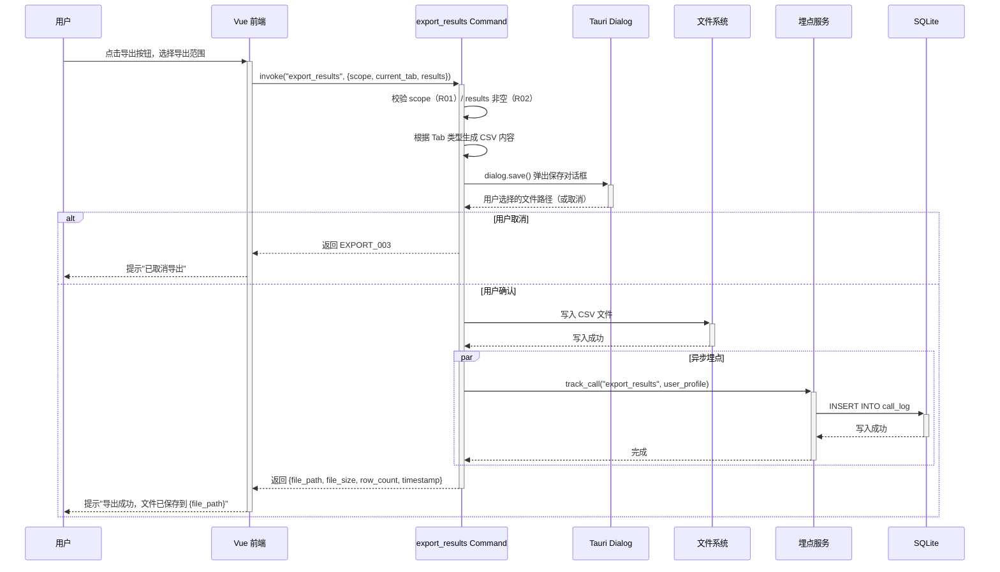

**业务规则：**

| 规则编号 | 规则描述 | 校验时机 | 不满足时的处理 |
|----------|----------|----------|--------------|
| R01 | scope 仅接受 current/all | 调用时 | 返回 EXPORT_001 |
| R02 | results 不能为空 | 调用时 | 返回 EXPORT_002 |
| R03 | 通过 Tauri Dialog 让用户选择保存路径 | 文件保存前 | 用户取消返回 EXPORT_003 |
| R04 | CSV 表头根据 Tab 类型动态生成 | 生成 CSV 时 | 不适用 |

**异常场景：**

| 异常场景 | 处理方式 |
|----------|----------|
| 文件写入权限不足 | 返回 EXPORT_004，提示"文件写入失败，请检查权限" |
| 磁盘空间不足 | 返回 EXPORT_004，提示"磁盘空间不足" |
| 用户取消保存对话框 | 返回 EXPORT_003，前端提示"已取消导出" |

**并发控制：**
- 并发场景：无并发风险，原因：桌面应用单用户操作。

---

### 5.3 埋点模块

#### 5.3.1 表结构设计

##### 5.3.1.1 call_log（接口调用埋点记录表）

| 字段名 | 数据类型 | 约束 | 默认值 | 说明 |
|--------|----------|------|--------|------|
| id | integer | PK, 自增 | - | 系统自增主键 |
| interface_name | varchar(50) | NOT NULL | - | 调用的接口名称（helloworld/hash_algorithm/bubble_sort/export_results） |
| caller_id | varchar(128) | NOT NULL | - | 调用人标识（机器 UID） |
| user_type | varchar(32) | NOT NULL | 'unknown' | 人员类型（developer/tester/product_manager/other） |
| user_level | varchar(32) | NOT NULL | 'unknown' | 人员层级（junior/mid/senior/expert） |
| user_department | varchar(128) | NOT NULL | 'unknown' | 人员部门 |
| call_time | datetime | NOT NULL | CURRENT_TIMESTAMP | 调用时间 |
| gmt_create | datetime | NOT NULL | CURRENT_TIMESTAMP | 创建时间 |

**索引：**
- IDX: `idx_call_log_call_time` (call_time) — 支持按时间范围查询
- IDX: `idx_call_log_interface` (interface_name) — 支持按接口名称筛选
- IDX: `idx_call_log_user_type` (user_type) — 支持按人员类型聚合
- IDX: `idx_call_log_user_level` (user_level) — 支持按人员层级聚合
- IDX: `idx_call_log_department` (user_department) — 支持按部门聚合

##### 5.3.1.2 枚举与常量定义

| 枚举名称 | 取值 | 含义 | 关联字段 |
|----------|------|------|----------|
| UserType | developer | 开发者 | call_log.user_type |
| UserType | tester | 测试人员 | call_log.user_type |
| UserType | product_manager | 产品经理 | call_log.user_type |
| UserType | other | 其他 | call_log.user_type |
| UserLevel | junior | 初级 | call_log.user_level |
| UserLevel | mid | 中级 | call_log.user_level |
| UserLevel | senior | 高级 | call_log.user_level |
| UserLevel | expert | 专家 | call_log.user_level |
| Dimension | user_type | 人员类型维度 | 查询接口入参 |
| Dimension | user_level | 人员层级维度 | 查询接口入参 |
| Dimension | user_department | 人员部门维度 | 查询接口入参 |
| Dimension | interface_name | 接口名称维度 | 查询接口入参 |
| ChartType | line | 折线图 | 前端图表类型 |
| ChartType | pie | 饼图 | 前端图表类型 |
| ChartType | bar | 柱状图 | 前端图表类型 |

#### 5.3.2 接口详细设计

##### T05 查询埋点统计接口

- **URI**: Tauri Invoke `query_call_stats`
- **描述**: 按指定维度和时间范围查询调用统计数据，返回前端图表所需的数据结构
- **入参**:

| 参数名称 | 类型 | 是否必填 | 描述 |
|----------|------|----------|------|
| dimension | String | 是 | 统计维度：user_type / user_level / user_department / interface_name |
| time_range | String | 否 | 时间范围：7d（最近7天，默认）/ 30d（最近30天）/ all（全部） |
| chart_type | String | 否 | 图表类型提示：line / pie / bar（影响返回数据结构排序方式） |

- **出参**:

| 参数名称 | 类型 | 描述 |
|----------|------|------|
| dimension | String | 实际查询的维度 |
| time_range | String | 实际查询的时间范围 |
| total_calls | i32 | 总调用次数 |
| categories | Array<String> | 维度分类列表（如人员类型各枚举值） |
| series | Array<Object> | 数据系列，每个对象包含 name 和 data 数组 |
| series[].name | String | 系列名称（如 "调用次数"） |
| series[].data | Array<i32> | 各分类对应的调用次数 |
| time_series | Array<Object> | 时间维度数据（折线图使用），每个对象包含 date 和 count |
| time_series[].date | String | 日期（yyyy-MM-dd） |
| time_series[].count | i32 | 当日调用次数 |

- **错误码**:

| 错误码 | 说明 |
|--------|------|
| TRACK_001 | dimension 参数值非法 |
| TRACK_002 | 数据库查询失败 |
| TRACK_003 | 数据库未初始化 |

- **业务规则**:
  - R01：dimension 仅接受 user_type / user_level / user_department / interface_name，否则返回 TRACK_001。
  - R02：time_range 默认为 7d，支持 7d / 30d / all。
  - R03：当 chart_type 为 line 时，time_series 字段填充按日期聚合的数据；当 chart_type 为 pie/bar 时，categories 和 series 字段填充按维度聚合的数据。
  - R04：total_calls 为当前时间范围内的总调用次数。

- **请求示例**:
```json
{
  "dimension": "user_type",
  "time_range": "7d",
  "chart_type": "pie"
}
```

- **响应示例**:
```json
{
  "dimension": "user_type",
  "time_range": "7d",
  "total_calls": 42,
  "categories": ["developer", "tester", "product_manager", "other"],
  "series": [
    {
      "name": "调用次数",
      "data": [20, 12, 7, 3]
    }
  ],
  "time_series": []
}
```

##### T06 保存用户人员信息接口

- **URI**: Tauri Invoke `save_user_profile`
- **描述**: 保存当前用户的人员类型、层级、部门信息到 Tauri Store
- **入参**:

| 参数名称 | 类型 | 是否必填 | 描述 |
|----------|------|----------|------|
| user_type | String | 是 | 人员类型：developer / tester / product_manager / other |
| user_level | String | 是 | 人员层级：junior / mid / senior / expert |
| user_department | String | 是 | 人员部门名称 |

- **出参**:

| 参数名称 | 类型 | 描述 |
|----------|------|------|
| success | bool | 是否保存成功 |
| caller_id | String | 当前机器 UID（调用人标识） |

- **错误码**:

| 错误码 | 说明 |
|--------|------|
| PROFILE_001 | user_type 参数值非法 |
| PROFILE_002 | user_level 参数值非法 |
| PROFILE_003 | Tauri Store 写入失败 |

- **业务规则**:
  - R01：user_type 仅接受枚举值，否则返回 PROFILE_001。
  - R02：user_level 仅接受枚举值，否则返回 PROFILE_002。
  - R03：caller_id 通过 `machine-uid` crate 获取当前机器唯一标识。

- **请求示例**:
```json
{
  "user_type": "developer",
  "user_level": "senior",
  "user_department": "前端架构组"
}
```

- **响应示例**:
```json
{
  "success": true,
  "caller_id": "a1b2c3d4-e5f6-7890-abcd-ef1234567890"
}
```

##### T07 获取用户人员信息接口

- **URI**: Tauri Invoke `get_user_profile`
- **描述**: 从 Tauri Store 读取当前用户的人员信息配置
- **入参**: 无

- **出参**:

| 参数名称 | 类型 | 描述 |
|----------|------|------|
| user_type | String | 人员类型，未配置时为 null |
| user_level | String | 人员层级，未配置时为 null |
| user_department | String | 人员部门，未配置时为 null |
| caller_id | String | 当前机器 UID |
| is_configured | bool | 是否已完成人员信息配置 |

- **错误码**:

| 错误码 | 说明 |
|--------|------|
| PROFILE_004 | Tauri Store 读取失败 |

- **业务规则**:
  - R01：首次使用（未配置）时 is_configured 为 false，前端引导用户填写人员信息。
  - R02：caller_id 始终返回，即使人员信息未配置。

- **请求示例**:
```json
{}
```

- **响应示例**:
```json
{
  "user_type": "developer",
  "user_level": "senior",
  "user_department": "前端架构组",
  "caller_id": "a1b2c3d4-e5f6-7890-abcd-ef1234567890",
  "is_configured": true
}
```

#### 5.3.3 子功能详细设计

##### 5.3.3.1 埋点记录流程（F06）

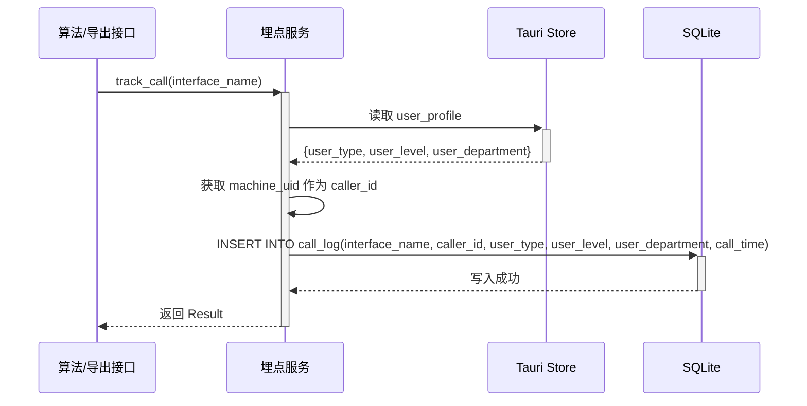

**业务规则：**

| 规则编号 | 规则描述 | 校验时机 | 不满足时的处理 |
|----------|----------|----------|--------------|
| R01 | 读取 Tauri Store 获取人员信息 | 每次调用 | 读取失败时使用 "unknown" 默认值 |
| R02 | 获取 machine_uid 作为 caller_id | 每次调用 | 获取失败时使用 "unknown" |
| R03 | 写入 call_log 表 | 每次调用 | 写入失败仅记录日志，不阻断主接口 |

**异常场景：**

| 异常场景 | 处理方式 |
|----------|----------|
| Tauri Store 未配置人员信息 | 使用 "unknown" 作为默认值写入，不阻断流程 |
| machine_uid 获取失败 | 使用 "unknown" 作为 caller_id |
| SQLite 连接不可用 | 跳过写入，记录 warn 日志 |

**并发控制：**
- 并发场景：SQLite 写入可能存在并发（多个 Tauri Command 同时被调用）。
- 控制策略：使用 `Arc<Mutex<Connection>>` 包装 SQLite 连接，保证写入串行化。由于埋点写入为异步且数据量极小，互斥锁不会成为性能瓶颈。

##### 5.3.3.2 埋点查询流程（F07/F08/F09/F10）

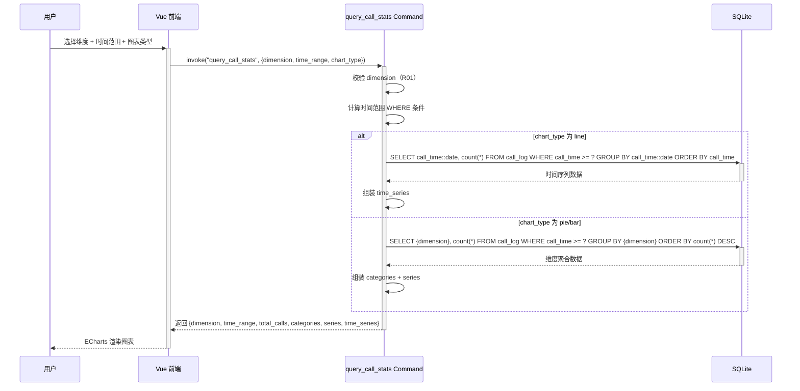

**业务规则：**

| 规则编号 | 规则描述 | 校验时机 | 不满足时的处理 |
|----------|----------|----------|--------------|
| R01 | dimension 仅接受枚举值 | 调用时 | 返回 TRACK_001 |
| R02 | time_range 默认 7d | 调用时 | 不适用 |
| R03 | line 图表返回时间序列数据 | 查询时 | 不适用 |
| R04 | pie/bar 图表返回维度聚合数据 | 查询时 | 不适用 |

**异常场景：**

| 异常场景 | 处理方式 |
|----------|----------|
| 数据库无数据 | 返回空的 categories/series/time_series，total_calls 为 0，前端展示空图表状态 |
| 查询超时 | 设置 5 秒查询超时，超时返回 TRACK_002 |

**并发控制：**
- 并发场景：SQLite 读取与写入可能并发。
- 控制策略：使用 `Arc<Mutex<Connection>>` 共享连接，读取时获取锁。由于查询频率低（用户手动触发），不会产生竞争。

---

### 5.4 前端算法演示页面模块

#### 5.4.1 表结构设计

本模块无独立表结构设计。前端组件不涉及数据持久化，页面状态通过 Pinia Store 和组件响应式数据管理。

#### 5.4.2 枚举与常量定义

| 枚举名称 | 取值 | 含义 |
|----------|------|------|
| TabName | helloworld | HelloWorld Tab |
| TabName | hash_algorithm | 哈希算法 Tab |
| TabName | bubble_sort | 冒泡排序 Tab |
| SortOrder | asc | 升序 |
| SortOrder | desc | 降序 |

#### 5.4.3 接口详细设计

本模块为前端 Vue 组件，不独立定义接口。前端通过调用后端 Tauri Command 接口（T01-T07）完成数据交互。

#### 5.4.4 子功能详细设计

##### 5.4.4.1 页面整体结构（F04）

页面路由：`/algo-demo`（在 Vue Router 中新增路由配置）

页面布局从上到下分为三个区域：
1. **Tab 区域**：Element Plus `el-tabs` 组件，包含三个 Tab Pane（HelloWorld / 哈希算法 / 冒泡排序），切换 Tab 展示不同算法的输入表单和执行结果。
2. **导出按钮区域**：位于 Tab 区域右上角，包含"导出当前"和"导出全部"两个按钮，点击后调用导出接口。
3. **报表区域**：位于 Tab 区域下方，包含维度选择器（下拉框）、时间范围选择器（单选按钮组）、图表类型切换器（按钮组），以及 ECharts 图表渲染区域。

**页面组件树：**
- `AlgoDemoPage.vue`（页面根组件）
  - `el-tabs`（Tab 容器）
    - `HelloWorldTab.vue`（HelloWorld Tab 内容）
    - `HashAlgorithmTab.vue`（哈希算法 Tab 内容）
    - `BubbleSortTab.vue`（冒泡排序 Tab 内容）
  - `ExportButtons.vue`（导出按钮组件）
  - `ReportPanel.vue`（报表区域组件）
    - `DimensionSelector.vue`（维度选择器）
    - `TimeRangeSelector.vue`（时间范围选择器）
    - `ChartTypeSwitcher.vue`（图表类型切换器）
    - `ChartRenderer.vue`（ECharts 图表渲染器）
  - `UserProfileDialog.vue`（人员信息配置弹窗，首次使用时弹出）

##### 5.4.4.2 HelloWorld Tab（F04）

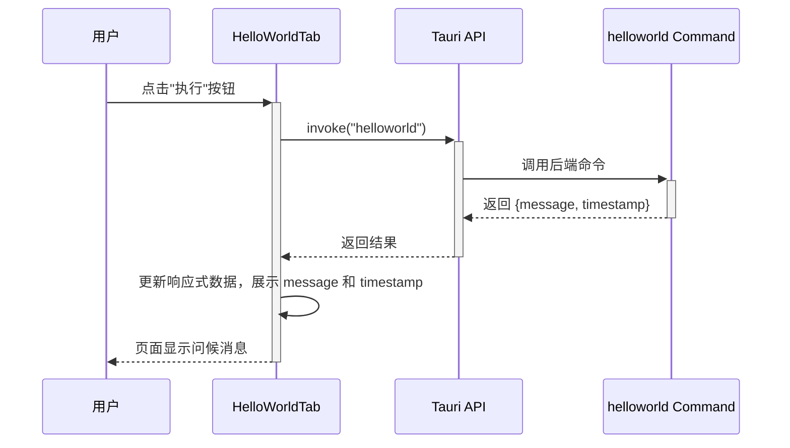

**UI 设计：**
- 一个"执行"按钮
- 结果展示区域：显示返回的 message 文本和 timestamp

##### 5.4.4.3 哈希算法 Tab（F04）

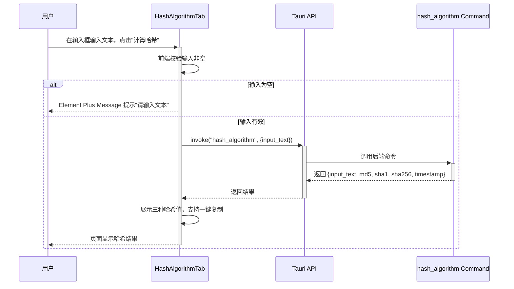

**UI 设计：**
- 文本输入框（el-input，textarea 模式）
- "计算哈希"按钮
- 结果展示区域：三行分别显示 MD5 / SHA-1 / SHA-256 哈希值，每行附带"复制"按钮（使用 `@tauri-apps/plugin-clipboard-manager`）

##### 5.4.4.4 冒泡排序 Tab（F04）

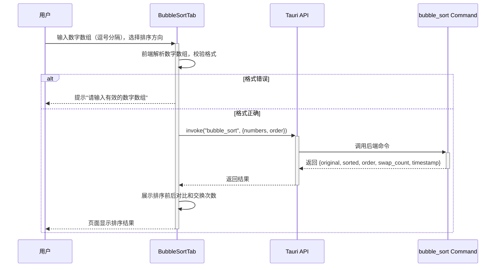

**UI 设计：**
- 数字输入框（el-input，提示"请输入数字，用逗号分隔，如：5,3,8,1,9"）
- 排序方向选择器（el-radio-group：升序 / 降序）
- "执行排序"按钮
- 结果展示区域：显示原始数组、排序后数组、交换次数

##### 5.4.4.5 导出功能（F05）

```mermaid
sequenceDiagram
    participant C as 用户
    participant FE as ExportButtons
    participant API as Tauri API
    participant Cmd as export_results Command

    C->>+FE: 点击"导出当前"或"导出全部"
    FE->>FE: 收集当前 Tab 或全部 Tab 的最近执行结果
    alt 无可导出数据
        FE-->>C: 提示"暂无可导出的数据，请先执行算法"
    else 有数据
        FE->>+API: invoke("export_results", {scope, current_tab, results})
        API->>+Cmd: 调用后端命令
        Cmd->>Cmd: 弹出文件保存对话框
        alt 用户取消
            Cmd-->>API: 返回 EXPORT_003
            API-->>-FE: 返回取消
            FE-->>C: 提示"已取消导出"
        else 用户确认
            Cmd-->>API: 返回 {file_path, file_size, row_count}
            API-->>-FE: 返回导出结果
            FE-->>-C: ElMessage 提示"导出成功，文件已保存到 {file_path}"
        end
    end
```

**UI 设计：**
- "导出当前"按钮（导出当前激活 Tab 的结果）
- "导出全部"按钮（导出所有 Tab 的结果）
- 导出成功/失败后使用 Element Plus `ElMessage` 提示

##### 5.4.4.6 可视化报表（F07/F08/F09/F10）

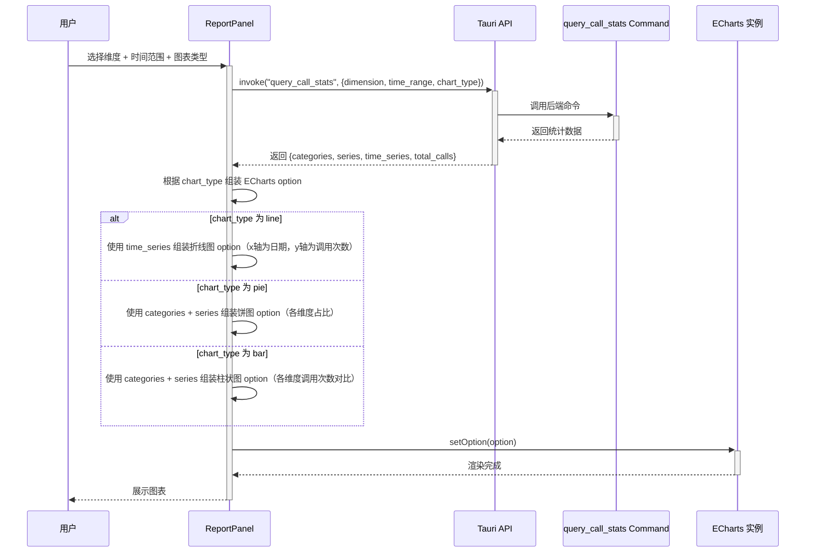

**UI 设计：**
- 维度选择器：el-select 下拉框，选项包括"人员类型"、"人员层级"、"人员部门"、"接口名称"
- 时间范围选择器：el-radio-group，选项包括"最近7天"、"最近30天"、"全部"
- 图表类型切换器：el-button-group，三个按钮分别对应折线图、饼图、柱状图
- 图表渲染区域：一个 div 容器，ECharts 初始化后挂载
- 图表上方显示总调用次数

**ECharts 集成方案选型：**

| 方案 | 描述 | 优点 | 缺点 |
|------|------|------|------|
| 方案 A：echarts + vue-echarts | 使用官方 echarts 核心包 + vue-echarts 组件封装 | Vue 3 原生支持、响应式自动更新、API 清晰 | 需引入两个包 |
| 方案 B：echarts 直接使用 | 仅引入 echarts 核心包，手动管理实例生命周期 | 包体积更小、无额外依赖 | 需手动处理 resize、销毁等生命周期 |
| 方案 C：chart.js + vue-chartjs | 使用 Chart.js 图表库 | 轻量 | 图表类型不如 ECharts 丰富，中文文档少 |

**推荐方案：方案 A（echarts + vue-echarts）**
**推荐理由**：vue-echarts 提供 Vue 3 响应式封装，与现有 Vue 3 + Element Plus 技术栈契合度高，自动处理 resize 和销毁；echarts 对折线图、饼图、柱状图三种图表类型支持完善，中文文档和社区生态成熟。

---

### 5.5 跨模块时序图

#### 5.5.1 完整调用链路（用户执行算法 → 埋点 → 报表查看）

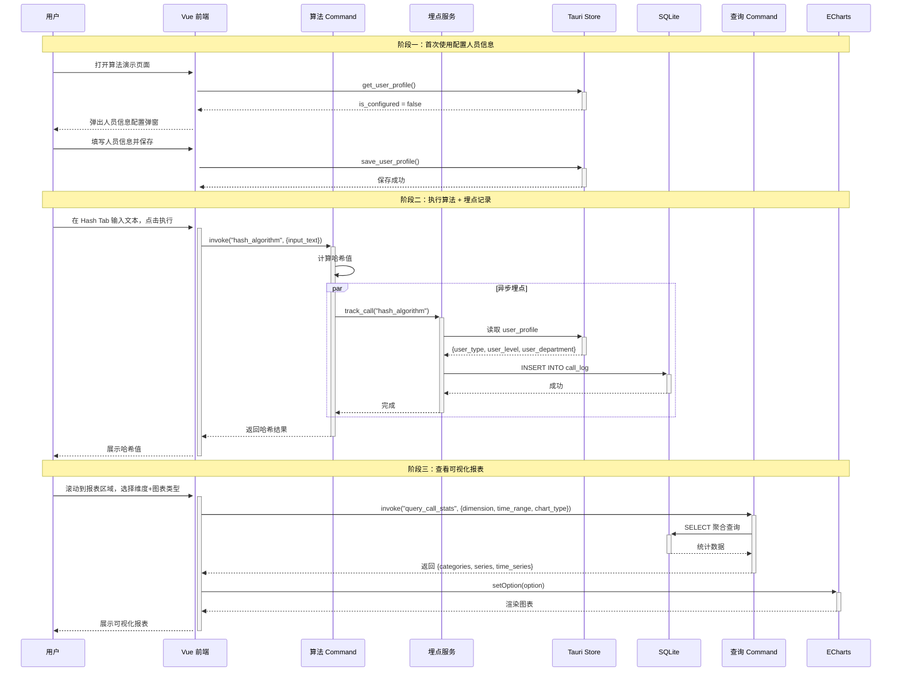

---

## 6. 非功能性需求设计

### 6.1 高可用性

- **数据库异常降级**：当 SQLite 数据库文件损坏或不可用时，埋点模块自动降级为跳过写入模式，算法接口正常返回结果，仅报表区域展示"数据不可用"提示。不影响核心算法演示功能。
- **Tauri Store 异常降级**：当 Tauri Store 读取失败时，人员信息使用 "unknown" 默认值，不阻断埋点记录流程。
- **图表渲染异常降级**：当 ECharts 渲染失败时（如数据格式异常），前端捕获异常并展示"图表渲染失败，请重试"提示。

### 6.2 可扩展性

- **算法接口扩展**：三个算法接口采用统一的 Tauri Command 模式，后续新增算法接口只需新增 Command 函数并在前端新增 Tab。
- **埋点维度扩展**：call_log 表的字段设计支持后续新增维度字段（在已有字段后面追加），查询接口的 dimension 参数可扩展新的枚举值。
- **图表类型扩展**：前端 ChartRenderer 组件采用策略模式，根据 chart_type 分发不同的 ECharts option 组装逻辑，新增图表类型只需新增一个策略分支。

### 6.3 稳定性/可靠性

- **输入边界保护**：哈希算法接口限制输入文本最大 1MB；冒泡排序接口限制数组最大 10000 个元素，防止内存溢出。
- **埋点写入不阻断**：所有埋点操作均为异步执行，设置 3 秒超时，超时后放弃写入，不影响主接口响应。
- **SQLite 连接管理**：使用 `Arc<Mutex<Connection>>` 全局共享连接，应用启动时初始化，应用退出时自动释放。数据库文件存放在 Tauri 应用数据目录，由操作系统保证文件持久性。

### 6.4 安全性设计

#### 6.4.1 账户系统方案

本项不适用，原因：桌面应用无账户系统，不涉及登录注册。用户身份通过本地机器 UID（machine-uid crate）标识。

#### 6.4.2 授权&访问控制

##### 6.4.2.1 是否实现水平权限检查

本项不适用，原因：桌面应用单用户本地使用，无水平权限隔离需求。

##### 6.4.2.2 是否实现垂直权限检查

本项不适用，原因：桌面应用无角色权限体系。

##### 6.4.2.3 是否检查登录态

本项不适用，原因：桌面应用无需登录，应用启动即可使用。

#### 6.4.3 数据防护方案

##### 6.4.3.1 是否对敏感数据加密存储

本项不适用，原因：埋点数据（调用日志、人员类型/层级/部门）不包含敏感个人信息（如身份证、手机号等），无需加密存储。机器 UID 为设备标识非敏感数据。人员部门为用户自行输入的非敏感组织信息。

##### 6.4.3.2 是否对敏感数据展示进行脱敏

本项不适用，原因：展示内容为算法结果和调用统计数据，不涉及敏感信息脱敏。

### 6.5 监控/统计/日志/告警

- **Rust 日志**：使用 `log` crate（或 `tracing`）记录关键操作日志，包括：
  - 埋点写入失败：warn 级别
  - 数据库初始化失败：error 级别
  - 导出文件写入失败：error 级别
  - 算法接口调用：info 级别（含接口名称和耗时）
- **前端日志**：使用 `console.log/warn/error` 记录前端异常，开发环境启用 vconsole（已在 index.html 中引入）。
- **本地统计**：call_log 表本身即为调用统计的数据源，前端报表区域提供可视化查看。

---

## 7. 变更三板斧

### 7.1 可监控

- **接口调用埋点**：三个算法接口和导出接口每次调用均写入 call_log 表，记录接口名称、调用人、调用时间、人员维度信息。前端报表区域提供可视化查看。
- **埋点写入自身监控**：埋点写入失败时通过 Rust 日志记录 warn 级别日志，便于排查。
- **导出操作监控**：导出接口同样触发埋点记录，可在报表中查看导出操作的使用情况。

### 7.2 可灰度

| 方案 | 描述 | 优点 | 缺点 |
|------|------|------|------|
| 方案 A：功能开关（Tauri Store） | 在 Tauri Store 中维护一个 `feature_algo_demo_enabled` 开关，应用启动时读取，为 true 时注册算法演示路由和 Command | 简单直接、用户可配置 | 桌面应用无服务端控制，开关需手动设置 |
| 方案 B：编译时 Feature Gate | 使用 Rust `cfg` feature flag 控制是否编译算法模块 | 零运行时开销 | 需重新编译，无法动态切换 |
| 方案 C：不做灰度 | 直接全量发布 | 最简单 | 无法快速回退 |

**推荐方案：方案 A（功能开关）**
**推荐理由**：桌面应用无服务端灰度平台，方案 A 通过本地 Tauri Store 开关实现动态启停，无需重新编译；同时可在应用设置页面提供开关入口，用户可自行控制。

### 7.3 可应急

- **功能开关回退**：通过 Tauri Store 将 `feature_algo_demo_enabled` 设为 false，应用重启后算法演示页面路由和 Command 不注册，相当于回退到无此功能的状态。不影响 PakePlus 核心的网页打包功能。
- **数据库隔离**：SQLite 数据库文件独立于应用核心数据，如数据库损坏可删除文件后重新初始化，不影响应用其他功能。
- **前端路由隔离**：算法演示页面为独立路由 `/algo-demo`，不影响现有页面。如前端组件异常，用户可直接导航到其他页面。
- **依赖隔离**：新增的 ECharts、echarts/vue-echarts 为前端依赖，不影响现有 Element Plus 等依赖；新增的 rusqlite 为 Rust 依赖，不影响现有 Tauri 插件。

---

## 8. 方案检查 Checklist

| 检查项 | 检查结果 | 说明 |
|--------|----------|------|
| 模块划分合理性检查 | 通过 | 四个模块（算法演示/导出/埋点/前端页面）职责单一，无循环依赖，无功能点超 50% 的模块 |
| 依赖关系合理性检查 | 通过 | 算法模块依赖埋点模块（单向），导出模块依赖算法模块和埋点模块（单向），前端依赖后端 Command（单向），无外部系统集成依赖 |
| 单点问题检查（部署层面） | 通过 | 桌面应用本地运行，无服务端单点问题；SQLite 为本地文件，无网络依赖 |
| 表模型设计范式检查 | 通过 | call_log 表满足第三范式（每个字段都依赖于主键且无传递依赖），人员信息冗余写入有合理业务原因（无法 JOIN Tauri Store） |
| 隐私安全检查 | 通过 | 接口中无敏感信息（身份证/手机号等），机器 UID 为设备标识非个人敏感信息，无需脱敏 |
| 兼容性检查（接口） | 通过 | 全部为新增 Tauri Command 接口，不影响现有接口，无兼容性问题 |
| 兼容性检查（表） | 通过 | call_log 为新增表，不影响现有数据结构 |
| 数据迁移检查 | 通过 | 新增 call_log 表在应用启动时自动创建（CREATE TABLE IF NOT EXISTS），无需数据迁移 |
| 一致性检查（功能点） | 通过 | F01-F10 全部在 Step 5 中有对应设计：F01→5.1.3 T01, F02→5.1.3 T02, F03→5.1.3 T03, F04→5.4.4, F05→5.2.4, F06→5.3.3.1, F07/F08/F09/F10→5.4.4.6 |
| 一致性检查（表） | 通过 | Step 3 的 call_log 实体在 Step 5.3.1 中有完整表结构定义 |
| 一致性检查（接口） | 通过 | Step 4 的 T01-T07 全部在 Step 5 中有详细定义 |
| 一致性检查（枚举） | 通过 | InterfaceType/HashAlgorithm/UserType/UserLevel/Dimension/ChartType 等枚举定义与表结构字段和接口参数一致 |
| 状态机完整性检查 | 不适用 | 本设计无含状态字段的实体，无需状态机 |
| 并发风险检查 | 通过 | SQLite 使用 Arc<Mutex<Connection>> 保证写入串行化；桌面应用单用户使用，无高并发场景 |
| 单点问题检查（定时任务层面） | 不适用 | 本设计无定时任务 |
| 非功能性设计可行性检查 | 通过 | 降级策略（数据库异常跳过埋点）、输入边界保护（1MB/10000元素）、异步埋点不阻断主流程均为可行方案 |
| 变更三板斧设计可行性检查（可监控） | 通过 | 埋点记录设计覆盖全部算法和导出接口，前端报表提供可视化查看 |
| 变更三板斧设计可行性检查（可灰度） | 通过 | 推荐方案 A（Tauri Store 功能开关），桌面应用场景下最实用 |
| 变更三板斧设计可行性检查（可应急） | 通过 | 功能开关回退 + 数据库隔离 + 路由隔离 + 依赖隔离，应急方案简单快速 |

---

## 附录：技术选型方案对比汇总

### A1. 数据存储方案对比

| 方案 | 描述 | 优点 | 缺点 |
|------|------|------|------|
| 方案 A：SQLite（rusqlite） | 使用 rusqlite crate 直接操作本地 SQLite 数据库 | 轻量、无需额外服务、SQL 查询能力强、支持索引和聚合 | 需手动管理连接和迁移 |
| 方案 B：Tauri Store（JSON） | 使用 tauri-plugin-store 以 Key-Value JSON 存储 | 已有依赖、使用简单 | 不支持 SQL 聚合查询，按维度统计需全量读取后内存计算 |
| 方案 C：SQLite（tauri-plugin-sql） | 使用 Tauri 官方 SQL 插件 | 官方维护、前端可直接查询 | 需额外引入插件、灵活性不如直接 rusqlite |

**推荐：方案 A（rusqlite）** — 项目已有 Rust 后端，rusqlite 直接在 Rust 层操作 SQLite，性能最优且支持复杂聚合查询，满足按多维度统计需求。

### A2. 图表库方案对比

详见 5.4.4.6 节 ECharts 集成方案选型，推荐 echarts + vue-echarts。

### A3. 哈希算法实现方案对比

| 方案 | 描述 | 优点 | 缺点 |
|------|------|------|------|
| 方案 A：Rust 标准库 + sha1/sha2 crate | 使用 `sha1`、`sha2` crate 计算 SHA-1/SHA-256，MD5 使用 `md5` crate | 纯 Rust 实现、性能高、无外部依赖 | 需引入 3 个 crate |
| 方案 B：调用系统命令 | 通过 `std::process::Command` 调用系统 `md5sum`/`shasum` 命令 | 无需额外 crate | 跨平台兼容性差（Windows 无这些命令）、性能差 |
| 方案 C：使用 ring crate | 使用 `ring` 统一密码学库 | 单一 crate 支持多种算法 | 不支持 MD5（ring 移除了不安全算法）、包体积大 |

**推荐：方案 A（sha1/sha2/md5 crate）** — 各 crate 轻量且专一，跨平台一致，MD5 虽不安全但用于演示场景足够。
